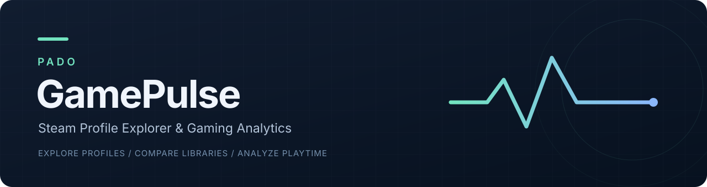
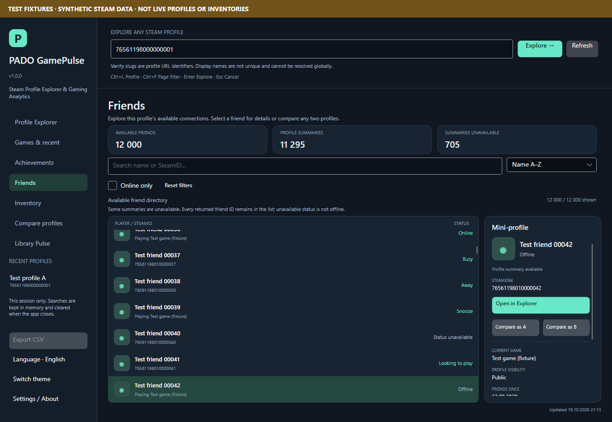
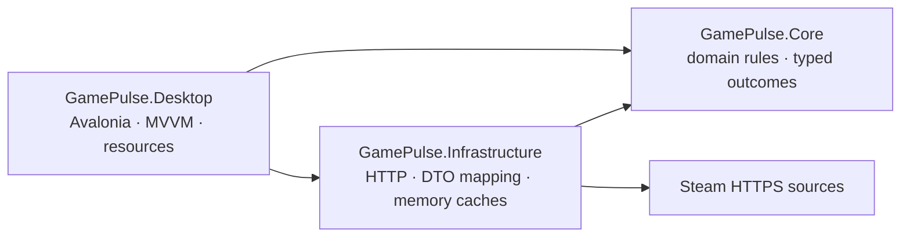

<p align="center">
  
</p>

<p align="center">
  <a href="https://github.com/PADOALEX/PADO-GamePulse/releases/tag/v1.0.0"></a>
  <a href="https://github.com/PADOALEX/PADO-GamePulse/actions/workflows/ci.yml"></a>
  
  <a href="LICENSE"></a>
</p>

**Explore any accessible Steam profile. Find shared games. Understand the library behind the numbers.**

PADO GamePulse is an independent desktop explorer built with **C#, .NET 10, Avalonia and MVVM**.
Enter a SteamID64, exact vanity slug or supported Steam Community profile URL. Explore the available
facts, compare two independently chosen profiles and keep unknown data visibly unknown.
No Steam sign-in, registration, mandatory database or backend is required.

**[Download 1.0.0](https://github.com/PADOALEX/PADO-GamePulse/releases/tag/v1.0.0)** ·
**[Release verification](docs/RELEASE_VERIFICATION.md)** ·
**[Architecture](docs/ARCHITECTURE.md)** ·
**[Українською](#українською)**


## What you can do

| Workspace | Useful details |
| --- | --- |
| **Profile Explorer** | Identity, avatar, online state, available level, account creation and source-provided ban facts. Progressive loading and session recents. |
| **Games & recent** | Search by name/AppID, filter lifetime hours or known never-played games, sort and inspect recent activity. Virtualized lists retain all available rows. |
| **Compare profiles** | Independently change Profile A and B. Compare available facts and find mutual AppIDs with both players' hours and filters. |
| **Friends** | Search, online filter, sorting, early avatars, async mini-profiles and one-click Explorer or Compare A/B navigation. |
| **Achievements** | Load only the selected game's details. Inspect names, descriptions, unlock dates and progress; weighted and per-game completion clearly describe the checked subset. |
| **Inventory** | CS2, TF2, Dota 2, PUBG, Rust and Steam Community. Editable contexts, cursor pagination, early icons, search, sorting, quantity-aware totals and explicit partial coverage. |
| **Library Pulse** | Hour distribution, top games, playtime concentration and known never-played share, calculated from the loaded library without another HTTP request. |
| **CSV export** | Export the current filtered Games/recent, Mutual Games or Inventory view. Retains source identity, timestamps, coverage and raw minutes; unknown values stay empty. |

English and Ukrainian switch immediately through the sidebar button, preserving opened profiles,
filters and selection. Dark, light and high-contrast themes share keyboard navigation, visible focus,
accessible names and layouts checked at multiple sizes and DPI scales.

<details>
<summary><strong>More screenshots</strong> — labeled test fixtures only</summary>




</details>

## Run on Windows

Download the **[setup EXE](https://github.com/PADOALEX/PADO-GamePulse/releases/download/v1.0.0/PADO.GamePulse-1.0.0-win-x64-setup.exe)**
or **[portable ZIP](https://github.com/PADOALEX/PADO-GamePulse/releases/download/v1.0.0/PADO.GamePulse-1.0.0-win-x64.zip)**.
The x64 packages include .NET; a separate runtime installation is unnecessary. For the ZIP, extract
the whole folder before starting `GamePulse.Desktop.exe`. The installer is per-user and includes an
uninstaller. Packages are unsigned; checksums and dependency notices accompany the release.

The app opens setup guidance without a key. To enable protected Steam Web API methods:

1. Create a private `.env` beside `GamePulse.Desktop.exe`.
2. Add your own permitted key after `GAMEPULSE_STEAM_API_KEY=` and save the file.
3. Restart the app. Enter a SteamID64, supported profile URL or exact vanity slug.

For example, use this structure **only in your local `.env`**:

```dotenv
GAMEPULSE_STEAM_API_KEY=
GAMEPULSE_UI_LANGUAGE=uk
```

`.env` is plain text and stays on your machine. It is excluded from Git, build resources and release
payloads; installer updates preserve a user-created copy. Never share it or put a key in `.env.example`.
Existing process environment variables take priority, followed by `.env` in the launch directory,
then `.env` beside the executable. Parent directories and the legacy Python key are never searched.
Use `GAMEPULSE_DISABLE_DOTENV=1` to disable local-file loading.

## Build from source

Install a **.NET 10 SDK**, clone the repository and run these commands from its root:

```powershell
dotnet restore PADO.GamePulse.sln --disable-parallel -m:1
dotnet build PADO.GamePulse.sln -c Release --no-restore -m:1
dotnet test PADO.GamePulse.sln -c Release --no-build -m:1
dotnet run --project tests/GamePulse.UiChecks -c Release --no-build -- artifacts/ui-checks
```

Copy [.env.example](.env.example) to a local `.env`, fill in your key, then launch:

```powershell
dotnet run --project src/GamePulse.Desktop -c Release
```

`dotnet run` uses the source root as the launch directory. Dependencies are explicitly versioned,
including Avalonia **12.1.4**. The UI checker is a separate test executable; it never provides fixtures
to the production application. CI is configured for Windows, Linux and macOS; native packages in this
release target Windows x64. Linux may need [Avalonia's platform dependencies](https://docs.avaloniaui.net/docs/platform-specific-guides/linux/).

| Shortcut | Action |
| --- | --- |
| `Ctrl+L` | Focus profile lookup |
| `Ctrl+F` | Focus the current page's filter, where available |
| `Enter` | Explore the entered profile |
| `Ctrl+Shift+E` | Export a supported current filtered view to CSV |
| `Ctrl+C` | Copy the selected identifier in Games/Friends |
| `Escape` | Close popups, then cancel current work |

CSV export uses a save dialog and makes no network requests. Identifiers carry an explicit text marker
to preserve all digits in spreadsheets. Fields are quoted, formula-like content is neutralized, and
timestamps use UTC. This is an explicit local export of available data, not a background archive.

## Engineering decisions



- **Honest availability:** empty, private, unavailable, rate-limited, failed and partial outcomes remain
  distinct. Missing facts never become zero playtime, clean ban status or a false empty intersection.
- **Responsive loading:** cancellation, generation guards, bounded concurrency, retry/backoff and
  observer-aware request deduplication prevent old responses from replacing a new search.
- **Bounded resources:** TTL memory caches, virtualized lists and cancellable visible-row thumbnails.
  Achievements load per selected game; Inventory starts on an explicit load action.
- **Separation of concerns:** Steam DTOs stay outside the views, pure domain rules stay testable, and
  localization lives in resources. No mandatory persistence layer or account system.
- **Secret-safe transport:** fixed HTTPS endpoints, normal TLS verification and diagnostics that avoid
  keys, key-bearing URLs and raw HTTP exceptions.

Tests cover domain rules, fake-HTTP responses, retry/cancellation/cache behavior, stale-result rejection,
CSV safety, live language changes, image lifetime and large virtualized lists. The real-view checker
exercises up to **12,000 rows** per list. These are synthetic validation scenarios, not claims about
live Steam speed. See the **[dated release verification](docs/RELEASE_VERIFICATION.md)** for executed
commands, results, installer checks and remaining external acceptance.

## Steam boundaries

The normal app reads real Steam sources; mock responses exist only in tests. Display names are not
unique lookup keys. Profile privacy, API permissions and source completeness limit what can be shown.
An HTTP 401/403 alone does not prove privacy. A complete returned list is not proof of every hidden
entitlement, and achievement aggregates describe only explicitly checked games.

Inventory uses Steam Community's read-only inventory endpoint, an implementation detail rather than
a guaranteed stable public Web API. Context availability can vary. There are no purchase-spend claims,
trust scores, market valuations or invented historical graphs. Read the [source notes](docs/LIVE_SOURCE_VERIFICATION.md)
and [security model](docs/SECURITY.md).

Fresh-key credentialed live checks, audible Narrator review and clean-machine/physical multi-monitor
acceptance are not claimed complete. Automated UI checks do not replace these reviews. GamePulse is
an independent project and is not affiliated with or endorsed by Valve.

## Project notes

[Architecture](docs/ARCHITECTURE.md) · [Library Pulse](docs/LIBRARY_PULSE.md) ·
[Windows packaging](docs/WINDOWS_RELEASE.md) · [Installer updates](docs/INSTALLER_UPGRADE.md) ·
[Accessibility acceptance](docs/ACCESSIBILITY_ACCEPTANCE.md) · [Changelog](CHANGELOG.md) ·
[Next steps](NEXT_STEPS.md) · [Contributing](CONTRIBUTING.md) · [Security reporting](SECURITY.md)

The migration began with an audit of a Python/Tkinter SteamChecker. Its original archive remains
unchanged; virtual environments, IDE files and credentials were not imported. See the
[audit](docs/AUDIT.md) and [migration map](docs/MIGRATION.md).

Released under the **[MIT License](LICENSE)**. Third-party dependencies retain their own licenses;
Windows payloads include the corresponding notices.

## Українською

**PADO GamePulse** — незалежний дослідник доступних Steam-профілів. Вводьте SteamID64,
точний vanity slug або підтримуване посилання на профіль; порівнюйте дві довільні бібліотеки,
переглядайте друзів, досягнення, інвентар та «Пульс бібліотеки». Вхід у Steam і база даних не потрібні.

Завантажте [реліз 1.0.0](https://github.com/PADOALEX/PADO-GamePulse/releases/tag/v1.0.0).
Створіть локальний `.env` біля EXE, впишіть власний ключ після `GAMEPULSE_STEAM_API_KEY=`
і перезапустіть програму. Для запуску з коду скопіюйте `.env.example` у `.env` в корені проєкту
та виконайте `dotnet run --project src/GamePulse.Desktop -c Release`.
Ключ залишається тільки у вашому локальному файлі — не додавайте його в Git або архіви.

Кнопка мови в бічній панелі перемикає українську й англійську одразу. `Ctrl+Shift+E` експортує
поточні відфільтровані Games/recent, Mutual Games або Inventory у CSV. Невідомі/недоступні дані
не перетворюються на нуль. Скриншоти містять явно позначені тестові дані; звичайний застосунок
отримує інформацію зі Steam. Фактичні перевірки та їхні межі наведено у
[звіті релізу](docs/RELEASE_VERIFICATION.md).