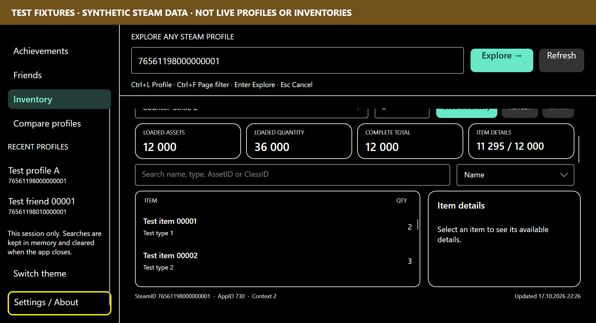
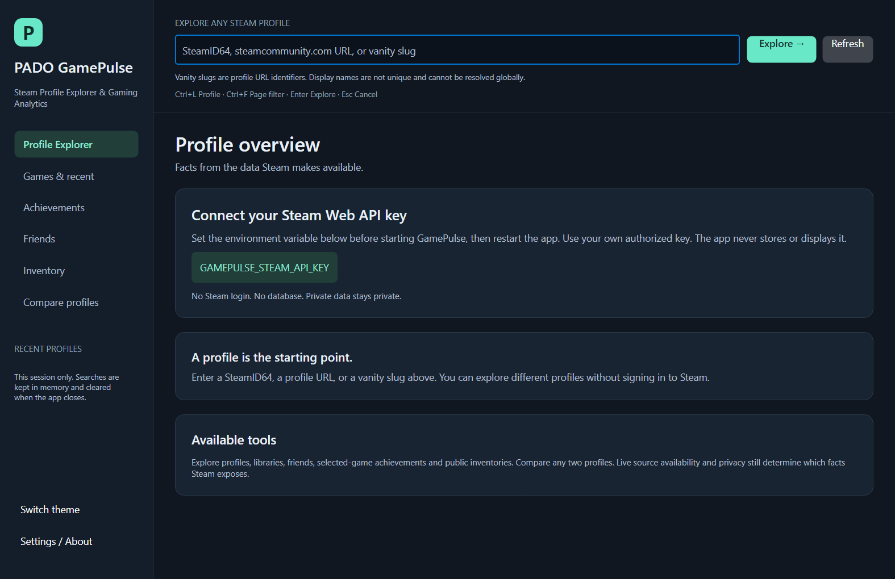

# DPI, accessibility and installer verification — 0.7.0

Executed on 2026-10-17 on Windows x64. The SDK is 10.0.102; unit/integration/headless checks used
installed runtime 10.0.2. Native portable/installed applications bundle .NET 10.0.13. Avalonia 12.1.4
remains the UI framework. No Steam key, login, database or production fixture was added.

## Implemented

- Explicit Windows PerMonitorV2 manifest, `asInvoker` execution and startup sizing using physical
  screen WorkingArea divided by scale. The default size now fits the current desktop work area.
- Supported logical minimum 840x480, compact sidebar/header and independent navigation scrolling.
  Global profile lookup remains visible. Ctrl+F brings the actual focused filter into view.
- Adaptive finite filter headers preserve the lists' own virtualized scrolling. Selected-game
  achievement controls also scroll independently so result rows survive short viewports.
- High-contrast palette (black/white/yellow focus), automatic response to platform contrast preference,
  session theme cycle, visible keyboard outlines, stable automation IDs, names and polite status metadata.
- A consistent local monogram icon for apphost/window/installer. No external raster art was required.
- Per-user Inno setup EXE with default LocalAppData Programs destination, Start menu shortcut,
  optional desktop shortcut, Installed apps registration, uninstaller and stable upgrade identity.
  The app remains self-contained. Installer/code-signing ownership and project license are not invented.

## Actual results

| Check | Result |
| --- | --- |
| Restore / Release build, seven projects | Exit 0; 0 errors, 0 warnings |
| Unit tests | 416 passed, 0 failed/skipped |
| Fake-HTTP integration tests | 301 passed, 0 failed/skipped |
| Full real-view headless executable | Exit 0, all existing large-list/lifecycle/image tests |
| DPI/theme matrix | 24 configurations, 144 page checks passed |
| Native UI Automation | Editable/focusable named input, ValuePattern, invalid-input status and six navigation InvokePatterns passed |
| Native DPI context | PerMonitorV2 verified through GetWindowDpiAwarenessContext; current monitor 120 DPI (125%) |
| Native startup | Six dark/light/contrast default/minimum captures; intentional screenshot failure exits 1 |
| Self-contained Windows publish | Runtime10.0.13; dependency notices for 38 production-graph packages plus runtime |
| Inno compiler | 7.1.0, exact SHA256 and valid Pyrsys signature checked; installer build exit0 |
| Isolated installer test | Install, HKCU registration, shortcut target, installed native startup/UIA, same-version reinstall and uninstall passed |
| User-file preservation | Unmanaged marker survived reinstall and uninstall; registry/managed EXE/shortcut removed |
| Archives | SHA256, ZIP CRC/path/exclusion checks and extraction; extracted native EXE startup checked |

Raw dated evidence: [DPI matrix](performance/release-070-dpi-accessibility-results.json),
[UI metrics](performance/release-070-ui-check-results.json),
[native provider](performance/release-070-native-accessibility-results.json),
[installer results](performance/release-070-installer-results.json).

The headless matrix calls Avalonia's actual SetRenderScaling extension at 100/125/150/200%, uses
Full HD and 2K logical working sizes, and visits Overview/Games/Compare/Friends/Achievements/Inventory
in dark/light/high-contrast themes. It checks focused-filter reachability, finite result viewports,
bounded realized rows and sidebar Settings reachability. Populated synthetic libraries/inventory are
prepared for these cases; synthetic screenshots stay labeled. It is not a physical monitor test.

Native UI Automation inspected only a newly launched child app's subtree, edited invalid input
without HTTP, checked focus and invoked navigation. It did not start Narrator, change global display
or contrast settings, or read any unrelated desktop window. Status metadata/name availability does
not certify spoken live-region behavior in every screen reader.

The installer test used a fresh workspace directory override, not the default real user app folder.
It refused existing product registrations/shortcuts. Its temporary HKCU registration and Start menu
shortcut were removed by the actual uninstaller. The unmanaged test marker and logs remain under
work only. The compiler was extracted locally after official archive SHA/signature validation;
no global compiler install, signing credential or external publication was used.





## Commands

From the source directory:

```powershell
dotnet restore PADO.GamePulse.sln --disable-parallel -m:1
dotnet build PADO.GamePulse.sln -c Release --no-restore -m:1
dotnet test PADO.GamePulse.sln -c Release --no-build --no-restore -m:1
dotnet run --project tests/GamePulse.UiChecks -c Release --no-build -- artifacts/ui-checks
powershell -NoProfile -ExecutionPolicy Bypass -File scripts/Publish-Windows.ps1 -OutputDirectory artifacts/windows
powershell -NoProfile -ExecutionPolicy Bypass -File scripts/Build-Installer.ps1 -PublishDirectory <publish-folder> -CompilerPath <verified-ISCC.exe> -OutputDirectory artifacts/installer
powershell -NoProfile -ExecutionPolicy Bypass -File scripts/Test-Installer.ps1 -InstallerPath <setup.exe> -TestDirectory <fresh-test-folder>
```

The full publish pipeline ran with verification enabled. Read [installer documentation](INSTALLER.md)
before running install/uninstall checks. [Windows packaging](WINDOWS_RELEASE.md) explains runtime
security maintenance. The prior [0.6 report](RELEASE_0_6_VERIFICATION.md) and real-source evidence remain.

## Limits and next acceptance

The artifact is unsigned; no project license is selected. Clean-machine execution, real multi-monitor
moves at different physical DPIs, OS high-contrast toggle/custom palettes, Narrator/NVDA spoken output,
interactive wizard accessibility, checked desktop-shortcut task and actual cross-version upgrade/
downgrade require further acceptance. Automated checks do not establish full WCAG compliance.
The app high-contrast palette detects the OS preference but does not clone every custom OS color.

No credentialed Steam live check ran in this phase. The latest public inventory observations are in
[live-source evidence](LIVE_SOURCE_VERIFICATION.md). Preserve privacy and rotate/revoke any key
distributed with the original Python archive; no legacy key was read. See [next tasks](../NEXT_STEPS.md).
