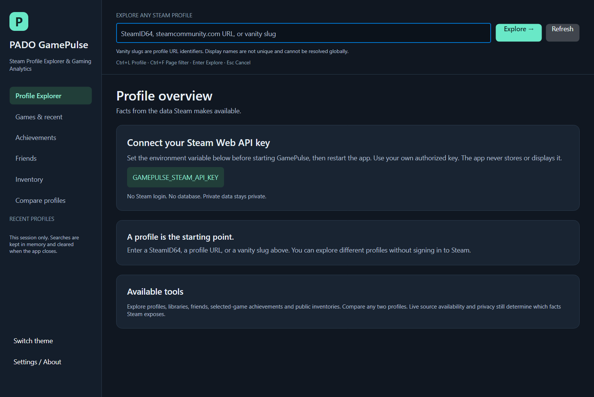
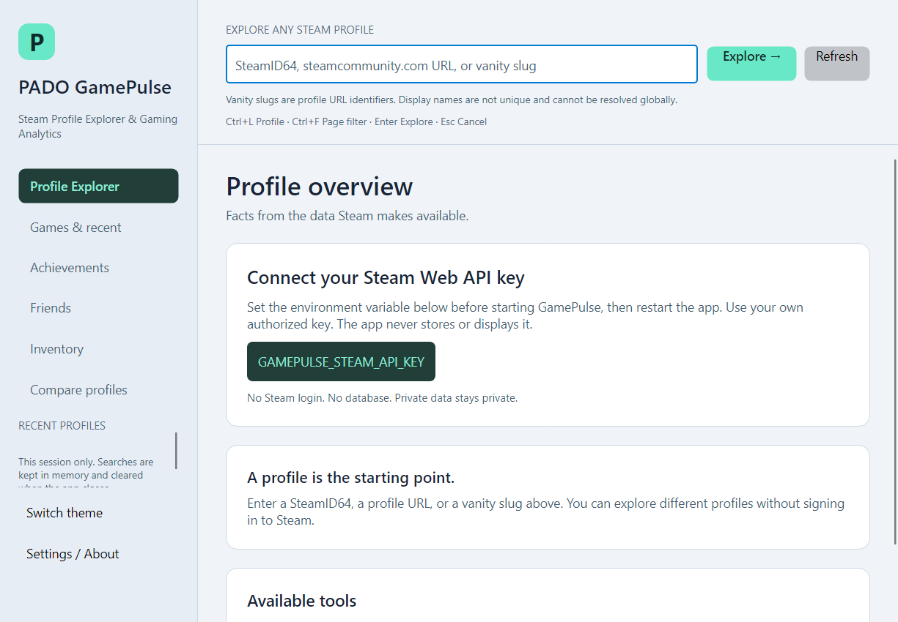

# Release verification — 0.6.0

Executed locally on Windows x64 on 2026-10-17. SDK 10.0.102 built the solution; unit/integration and
headless checks ran on installed .NET 10.0.2. The delivered native self-contained executable uses
**bundled .NET 10.0.13**, checked in runtime configuration and by starting that EXE directly.
Avalonia remains stable 12.1.4. No system SDK/runtime installation was performed.

## Executed checks

| Check | Actual result |
| --- | --- |
| Solution restore / Release build | Exit 0; zero warnings/errors; all seven projects |
| Unit tests | 416 passed; 0 failed/skipped |
| Fake-HTTP integration tests | 301 passed; 0 failed/skipped |
| Real-view headless UI executable | Exit 0; large lists, navigation, filters, states, images and themes |
| Public live Steam inventory/CDN checks | Exit 0; 7 inventory requests, 0 retries, 4 images; see separate evidence |
| NuGet vulnerability query, including transitive dependencies | No vulnerable packages reported in seven projects by the configured feed at check time |
| Self-contained win-x64 publish | Exit 0; runtime/apphost pinned to 10.0.13 |
| Dependency notices | 38 production-graph packages plus actual bundled runtime license/third-party notices |
| Native no-key EXE startup | Dark/light at default and minimum size; all exit 0 and write PNGs |
| Intentional native screenshot failure | File used as parent directory; process exits 1 as required |
| ZIP validation | SHA256, CRC, safe paths, exclusions and extraction checked; extracted Windows EXE starts |

The Windows pipeline is [Publish-Windows.ps1](../scripts/Publish-Windows.ps1). It ran the full
restore/build/test/UI/publish/native sequence; its `-SkipVerification` option was not used.
The script preserves staging and TRX/PNG diagnostics outside the portable folder. The artifact is
**unsigned**, carries no selected project license, and was not published to an external service.

## Confirmed changes

- Native Main returns Avalonia's exit code; startup smoke failures can no longer look successful.
- API and image transports disable cookies/implicit credentials; HTTPS and normal TLS remain required.
- Avatar URLs reject credentials/query/fragment and non-allowlisted hosts. Source image dimensions
  are checked before decode, both decoded axes are bounded to 128, and only valid decoded images
  enter the bounded TTL cache. Cancellation/disposal cannot publish a late image or cache write.
- Ctrl+F focuses the visible page filter; Ctrl+L always selects profile lookup. Escape reaches active
  controls before global cancellation. Games/Friends support ID copy. Settings scrolls into view.
- Six virtualized lists expose row automation names with identity and available metrics. Recent-history
  text reserves space for its scrollbar at the minimum native size.
- Windows packaging contains a security-patched runtime, dependency manifest and complete retained
  package/upstream/runtime notices. No login, database or production fixture was added.

## Real versus synthetic evidence

[Actual Steam checks](LIVE_SOURCE_VERIFICATION.md) verified CS2, TF2, Dota 2 and Steam Community
inventories with production services. Dota returned 1697 assets across two pages; Community returned
117 assets representing 416 units. PUBG/Rust HTTP401 remained Unavailable with unknown totals.
No existing inventory parser bug was confirmed; no speculative endpoint rewrite was made.

The [UI metrics](performance/release-ui-check-results.json) describe synthetic fixtures only:
12,000 Games/Friends/Achievement/Inventory rows, 6,000 mutual games, last-row access and bounded
realized containers. They do not measure native FPS or live-network latency. New assertions exercise
actual keyboard routing, clipboard ID copy, Settings visibility, accessible realized rows, avatar
TTL/eviction/independent bitmaps, invalid dimensions and recovery after rejected images.

Native setup screenshots below contain no profile data. Other screenshots remain visibly labeled
synthetic fixtures. The build machine rendered native setup at its current 125% display scale;
the default content capture is 1575x1055 and minimum capture 1225x850 pixels. This is one machine,
not a full DPI matrix or a screen-reader certification.





## Reproduce

From the source root with a supported .NET10 SDK:

```powershell
dotnet restore PADO.GamePulse.sln --disable-parallel -m:1
dotnet build PADO.GamePulse.sln -c Release --no-restore -m:1
dotnet test PADO.GamePulse.sln -c Release --no-build --no-restore -m:1
dotnet run --project tests/GamePulse.UiChecks -c Release --no-build -- artifacts/ui-checks
powershell -NoProfile -ExecutionPolicy Bypass -File scripts/Publish-Windows.ps1 -OutputDirectory artifacts/windows
```

Use a fresh output directory when a release archive already exists. See
[Windows packaging](WINDOWS_RELEASE.md) and [LiveChecks](../tools/GamePulse.LiveChecks/README.md)
for exact separate opt-in live commands. Keys belong only in the local process environment.

## Remaining verification boundaries

No fresh permitted Web API key was configured: profile/library/friends/achievement live acceptance
remains open. Missing-key/HTTP edge-case tests are not credentialed live evidence. Positive PUBG/Rust
inventories, broader contexts, native image decoding of selected live items, clean-machine Windows,
hosted CI, native Linux/macOS, broader DPI and Windows Narrator remain unverified.
No rate limit or private access was induced/bypassed. Keep the [next tasks](../NEXT_STEPS.md) explicit.
Rotate/revoke any key distributed with the original Python archive; no legacy secret was read/copied.
