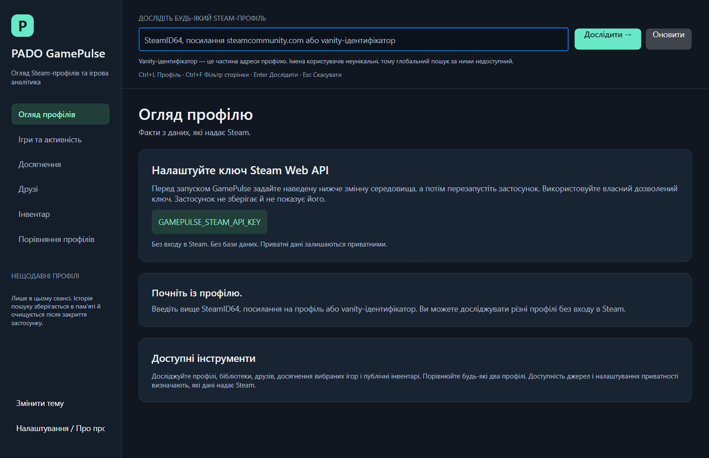
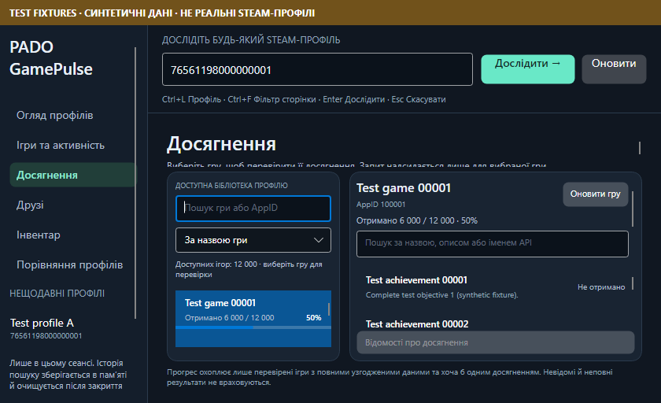

# Release verification — 0.8.0

Executed on 2026-10-17 on the existing Windows x64 machine. SDK 10.0.102 and installed
runtime 10.0.2 ran the automated tests; portable and installed apps bundle .NET 10.0.13.
Avalonia remains 12.1.4. This is a tested local release with explicit external acceptance gaps.

## Delivered changes

- Visible status text uses the framework text automation peer and polite live-region metadata.
  Hidden/detached page peers return Off, preventing background tabs from announcing their changes.
  Existing framework NamePropertyChanged behavior is used without manually duplicating native events.
- Six page headings and appropriate section headings expose heading levels. Current navigation exposes
  a localized ItemStatus while preserving its actual Button role. Progress text is not a live region.
- Fixed overlapping game sort/status rows in Achievements. Comparison validation status remains
  available to its peer for its first text change. Theme callbacks cannot update a disposed manager.
- Added 470 Ukrainian resource entries across six modules; English remains the default.
  `GAMEPULSE_UI_LANGUAGE=uk` selects Ukrainian at startup; OS number/date formatting is retained.
- Added stable installer concurrency/version guards and hash-verified retirement of obsolete files.
  Unknown, modified or reparse paths are preserved during retirement; no recursive application wipe.
- Added the owner-selected MIT LICENSE to source and binary packages. The Web API User-Agent now
  follows the assembly version. Added opt-in credentialed production-service diagnostics.
- Strengthened the optional native UIA test: invalid input must change the status to the exact
  localized message. The previous nonempty-text assertion could pass unchanged startup text.

## Actual results

| Check | Result |
| --- | --- |
| Solution restore / Release build | Exit 0; seven projects, 0 errors, 0 warnings |
| Unit tests | 422 passed; 0 failed/skipped |
| Fake-HTTP integration tests | 301 passed; 0 failed/skipped |
| Real-view headless executable | Exit 0; large lists, lifecycle, keyboard, images and availability checks |
| Resource parity | Six modules, all 470 Ukrainian keys and exact format placeholders |
| Live-region semantics | Actual control-peer name events, no duplicate consecutive name changes, hidden/detached Off, six page headings |
| DPI/theme matrix | 24 configurations, 144 page checks; actual headless render-scale changes |
| Ukrainian populated layout matrix | Two sizes × three themes × six pages = 36 passed checks |
| Native no-key startup | Eight English/Ukrainian default/minimum captures; negative output-path failure exits 1 |
| Self-contained publish | win-x64, runtime 10.0.13, 38 production-graph package notices plus runtime, MIT LICENSE and uk satellite |
| Installer build | Verified Inno 7.1.0 compiler; exit 0 |
| Actual 0.7.0 → 0.8.0 upgrade | Existing directory and selected desktop task retained; all 288 installed payload hashes match |
| Same-version reinstall | Passed; unmanaged marker retained |
| New setup version guards | Synthetic registered 0.10.0, malformed and missing versions each rejected with exit 1; payload unchanged |
| Retirement fixture | Separate test-only payload: unchanged retired PDB removed; modified retired PDB retained during upgrade |
| Actual uninstall | Registration, both shortcuts and managed files removed; unknown user file retained |
| Profile diagnostic no-key mode | Exit 3, MissingKey report, zero HTTP; invalid profile exit 1 and help exit 0 |

Final package CRC, SHA256, safe extraction and extracted native startup checks are recorded in
[package results](performance/release-080-package-results.json). Packaging does not add fixtures,
tests, key files, IDE files or the old Python environment to production output.

Raw evidence: [UI metrics](performance/release-080-ui-check-results.json),
[DPI matrix](performance/release-080-dpi-accessibility-results.json),
[Ukrainian layout matrix](performance/release-080-localized-layout-results.json),
[upgrade results](performance/release-080-installer-upgrade-results.json),
[explicit native UIA skip](performance/release-080-native-accessibility-results.json),
[no-key diagnostics](performance/release-080-live-profile-no-key-080.json).

The large-list observations use labeled synthetic fixtures confined to test projects: 12,000 games,
friends, achievements and inventory assets, plus 6,000 mutual games. The realized containers stay
bounded and last rows remain reachable. These local timings are not Steam latency or native FPS.
The Ukrainian matrix constructs fresh localized views at 1260×900 and 840×480 logical sizes and
checks focus/filter reachability, finite populated virtualized lists and sidebar Settings access.





## Narrator and native review boundary

The actual native app was launched and its setup UI accessibility tree inspected through Computer Use.
The tool subsequently reported that the user stopped desktop control with the physical Escape key.
No further interactive input was issued. Narrator spoken output, Speech Recap, native live-event
delivery and the interactive installer wizard are therefore **not marked passed**. The fresh native
UIA script and installed-app UIA were explicitly skipped in this run; 0.7 native provider checks
remain historical evidence only. Headless peer assertions passed but do not certify audible output.
See the concrete [Narrator acceptance checklist](ACCESSIBILITY_ACCEPTANCE.md).

## Steam and distribution boundary

No fresh permitted key was present at final verification. The newly added profile diagnostic mode
was built and its zero-network MissingKey path executed; credentialed live Summary/level/bans,
owned/recent, Friends, selected achievements and two-profile checks remain owner acceptance.
The [actual 0.6 inventory evidence](LIVE_SOURCE_VERIFICATION.md) is retained with its original date.
Positive PUBG/Rust and broader public/private/partial profile cases remain unverified live.
The legacy secret was never read, copied or reused. Revoke/rotate any key distributed in that archive.

The matching ZIP and setup are unsigned. The tests used this existing machine and an isolated
installation directory; they do not establish clean-machine, physical monitor, hosted CI,
Linux/macOS-native or accessibility certification. No external publication or auto-updater was added.
MIT was explicitly selected by the owner; third-party notices remain separate.

The new installer rejects a newer registered version. The already distributed 0.7 executable cannot
receive that guard retroactively and can still replace newer files if deliberately run over them.
For deliberate rollback, uninstall the current version first. Read [upgrade policy](INSTALLER_UPGRADE.md).

## Reproduction

From the source root:

```powershell
dotnet restore PADO.GamePulse.sln --disable-parallel -m:1
dotnet build PADO.GamePulse.sln -c Release --no-restore -m:1
dotnet test PADO.GamePulse.sln -c Release --no-build --no-restore -m:1
dotnet run --project tests/GamePulse.UiChecks -c Release --no-build -- artifacts/ui-checks
powershell -NoProfile -ExecutionPolicy Bypass -File scripts/Publish-Windows.ps1 -OutputDirectory artifacts/windows -SkipNativeAccessibility
powershell -NoProfile -ExecutionPolicy Bypass -File scripts/Build-Installer.ps1 -PublishDirectory <publish-folder> -CompilerPath <verified-ISCC.exe> -OutputDirectory artifacts/installer
powershell -NoProfile -ExecutionPolicy Bypass -File scripts/Test-InstallerUpgrade.ps1 -PreviousInstallerPath <0.7.0-setup.exe> -InstallerPath <0.8.0-setup.exe> -PublishDirectory <publish-folder> -TestDirectory <fresh-folder> -CompilerPath <verified-ISCC.exe> -SkipUiAutomation
```

The full publish pipeline ran with restore/build/tests enabled. An additional final solution build/test
and real-view run included the new Ukrainian populated-layout matrix and profile diagnostic tool.
Remove the explicit UIA skip switches when the owner resumes native desktop review. Test scripts
refuse existing registrations/shortcuts and retain their logs under the isolated work folder.
Historical [0.7 DPI/installer report](DPI_ACCESSIBILITY_VERIFICATION.md) and earlier reports remain unchanged.
