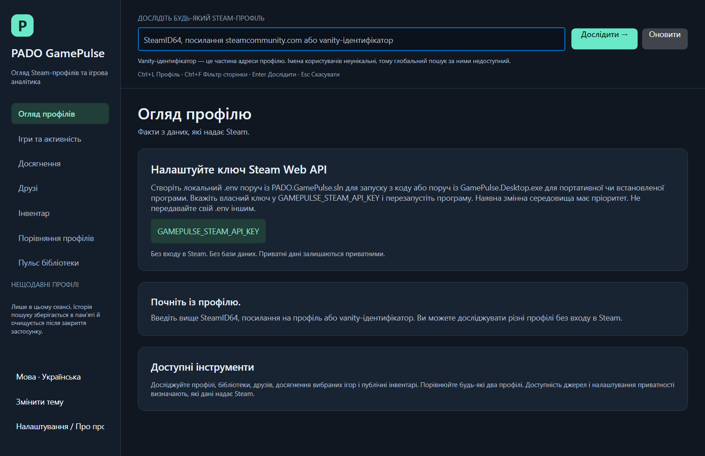
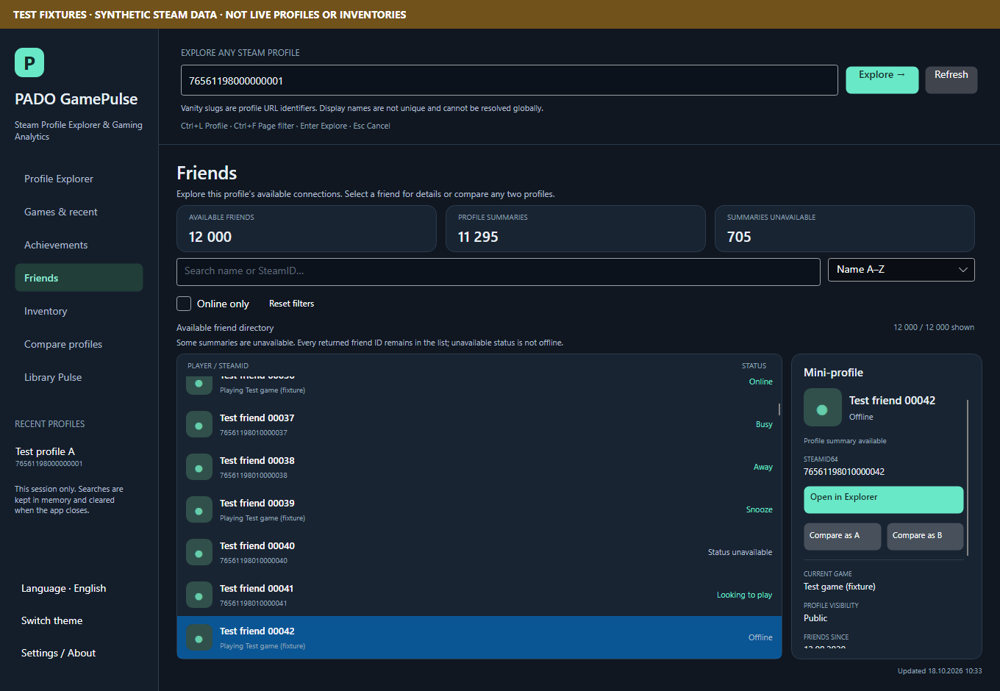
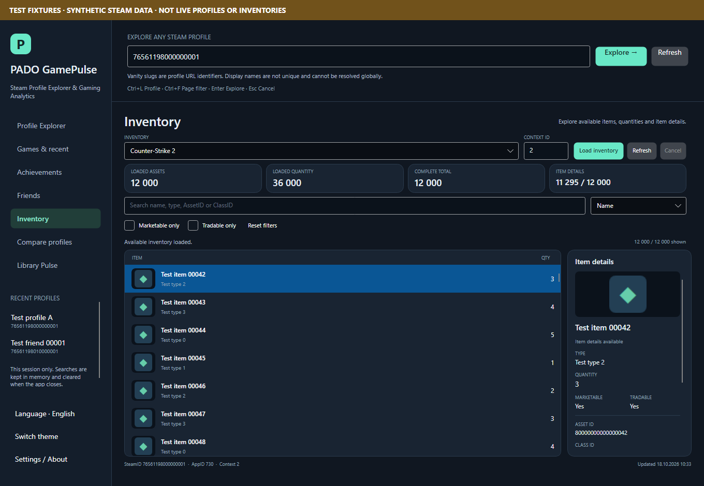
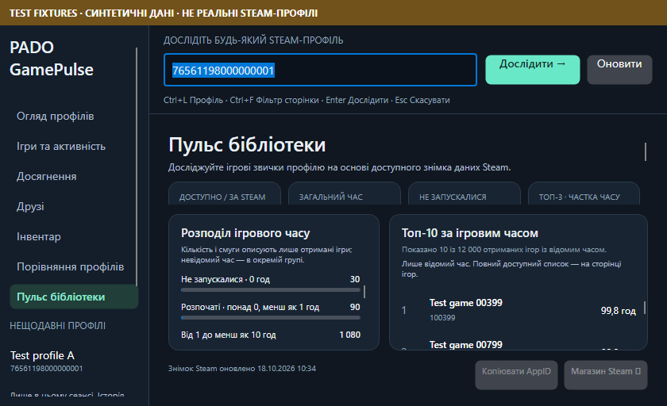

# Release verification — 0.9.0

Executed on 2026-10-18 on the existing Windows x64 machine. SDK 10.0.102 and installed
runtime 10.0.2 ran tests; portable/installed apps bundle .NET 10.0.13. Avalonia remains 12.1.4.
The [0.8 report](RELEASE_0_8_VERIFICATION.md) is preserved separately.

## Delivered behavior

- Desktop reads a private local `.env` at startup. Priority: existing environment value, launch-directory
  file, executable-directory file. No parent search, shell expansion, process-environment mutation,
  legacy-key reuse or key logging. Source runs use the solution root as the launch directory.
  Missing/invalid configuration keeps setup available. `GAMEPULSE_DISABLE_DOTENV=1` opts out.
- The sidebar language button switches English/Ukrainian immediately while preserving the window,
  controls, profiles, independent comparison inputs, lists, filters, sort indices, selections and typed
  user input. Number/date culture follows the OS. The button is session-only; configuration sets startup.
- Friends and inventory show visible-row previews before selection through the existing allowlisted
  HTTPS loaders and bounded cache/concurrency/decoding. Offscreen/hidden/detached/recycled rows cancel
  work, reject late results and dispose images. Failures retain fallbacks. No whole-list prefetch.
- **Library Pulse / Пульс бібліотеки** shows factual playtime distribution, top games, unplayed share
  and top-three concentration from the already loaded unfiltered library. No extra HTTP, database,
  invented history or demo profiles. Partial/unknown coverage keeps global totals unavailable.
  See [metric definitions](LIBRARY_PULSE.md).
- Fixed a real selection regression: event subscribers affected localized-record equality, causing
  refiltering to replace selected rows and reload images. Subscriber state no longer affects value
  equality. Stable localized option objects prevent ComboBox resets. Compact Pulse reserves list space.

## Executed checks

| Check | Result |
| --- | --- |
| Solution restore / Release build | Exit 0; 0 errors, 0 warnings |
| Unit tests | 470 passed; one Unix FIFO case intentionally skipped on Windows |
| Fake-HTTP integration tests | 301 passed; 0 failed/skipped |
| Total | **771 passed, 1 platform skip, 0 failures** |
| Resource parity | Seven modules, 521 Ukrainian entries; keys/placeholders match |
| Actual language button | Labels/accessibility update; data, filters, sort, selections, input and OS culture preserved |
| Thumbnail lifecycle | Visible loading, hiding/detaching cancellation, recycling, stale completion and disposal passed |
| Large lists | 12,000 games/friends/achievements/inventory assets; 6,000 mutual games; bounded realization, last rows reachable |
| DPI/themes | 24 configurations × seven pages = 168 passed checks |
| Ukrainian layout | Two sizes × three themes × seven pages = 42 passed checks |
| Native no-key startup | Eight English/Ukrainian default/minimum captures; bad screenshot parent exits 1 |
| Native Windows UIA | Passed: edit focus/ValuePattern, exact invalid status, seven navigation InvokePatterns, live language names/status, preserved input, PerMonitorV2 |
| Build secrecy | Dummy `.env` absent from None, Content, EmbeddedResource and AvaloniaResource; source launch directory verified |
| Safe source exporter | 25 exclusion fixtures; dummy credential bytes absent; unsafe example/path/reparse roots rejected; no overwrite; isolated Git-ignore checks |
| Publish | win-x64, .NET 10.0.13, 38 production package notices plus runtime, MIT LICENSE and Ukrainian satellite |

The full publish pipeline ran restore/build/tests/headless checks/native UIA without skip switches.
Only portable START_HERE instructions changed afterward before final ZIP creation; production binaries
remained identical. Installer and final package evidence is recorded below.

Raw results: [tests](performance/release-090-test-results.json),
[large-list observations](performance/release-090-ui-check-results.json),
[DPI](performance/release-090-dpi-accessibility-results.json),
[Ukrainian layouts](performance/release-090-localized-layout-results.json),
[native UIA](performance/release-090-native-accessibility-results.json),
[build exclusions](performance/release-090-dotenv-build-items.json),
[source-export safety](performance/release-090-source-archive-safety-results.json).

Timings describe labeled synthetic fixtures, not Steam latency, native FPS or real users. Fake sources
and images remain in tests; the normal application has no demo profile mode.









## Final installer, configuration and archive checks

The actual **0.8.0 → 0.9.0** installer upgrade passed without UIA skip switches. All 288 installed
payload hashes matched; install directory and desktop task survived. Same-version reinstall and
newer/missing/malformed registered-version rejections passed. A separate test-only retirement payload
removed an unchanged obsolete PDB and preserved a modified one. Uninstall removed managed files,
registration and both shortcuts. Exactly two unmanaged fixtures remained: the user marker and a
synthetic private `.env`, preserved through upgrade, reinstall, rejections, retirement and uninstall.
The installed app also passed native UIA. See [upgrade results](performance/release-090-installer-upgrade-results.json)
and [installed UIA](performance/release-090-installed-accessibility-results.json).

Five isolated startup scenarios passed with the published EXE on both Windows PowerShell 5.1 and
PowerShell 7.6.5: no-file setup, working-directory `.env`, opt-out, environment-language precedence
and graceful malformed-file setup. A PowerShell 7 test-harness issue was corrected: deleting a
variable requires NullString to distinguish absence from an explicitly empty value. The application
correctly preserves that distinction. No production binary change was needed. Reports contain only
configuration booleans; no profile was searched or real key used.
See [configuration results](performance/release-090-local-environment-results.json).

Final ZIP CRC, safe entry paths/extraction, all 288 file matches against the delivered portable folder,
license/resources/runtime and absence of local configuration/test artifacts passed. The extracted
EXE passed both no-key startup and `.env` fallback beside the executable from another working directory.
See [package results](performance/release-090-package-results.json) and
[extracted startup](performance/release-090-extracted-startup-results.json). The safe source exporter
creates the final source ZIP; delivery sidecars record SHA256 without including private local files.

## Acceptance boundaries

Native UIA passed. It does **not** establish audible Narrator output or screen-reader live-event delivery.
Spoken review and the interactive installer keyboard flow still need the
[Narrator acceptance session](ACCESSIBILITY_ACCEPTANCE.md).

The actual user's `.env` was not read into diagnostics, copied or used for live tests. Startup checks
use a deliberately synthetic credential and never search a profile. Fresh-key live Summary/level/bans,
owned/recent, Friends, achievements and two-profile acceptance remain an owner task. Earlier
[live inventory evidence](LIVE_SOURCE_VERIFICATION.md) retains its date/scope; positive PUBG/Rust
contexts remain unverified. No privacy bypass or deliberate rate-limit probing. Rotate/revoke any key
shared in the Python archive; it was not read or reused.

ZIP/setup are unsigned. Existing-machine tests do not certify clean Windows, physical multi-monitor
DPI, hosted CI, Linux/macOS native execution or audible accessibility. No external publication or
updater. MIT was chosen by the owner; dependency notices remain separate. Old installers cannot
receive newer version guards retroactively.

## Reproduction

From the source root:

```powershell
dotnet restore PADO.GamePulse.sln --disable-parallel -m:1
dotnet build PADO.GamePulse.sln -c Release --no-restore -m:1
dotnet test PADO.GamePulse.sln -c Release --no-build --no-restore -m:1
dotnet run --project tests/GamePulse.UiChecks -c Release --no-build -- artifacts/ui-checks
powershell -NoProfile -ExecutionPolicy Bypass -File scripts/Publish-Windows.ps1 -OutputDirectory artifacts/windows
powershell -NoProfile -ExecutionPolicy Bypass -File scripts/Build-Installer.ps1 -PublishDirectory <publish-folder> -CompilerPath <verified-ISCC.exe> -OutputDirectory artifacts/installer
powershell -NoProfile -ExecutionPolicy Bypass -File scripts/Test-InstallerUpgrade.ps1 -PreviousInstallerPath <0.8.0-setup.exe> -InstallerPath <0.9.0-setup.exe> -PublishDirectory <publish-folder> -TestDirectory <fresh-folder> -CompilerPath <verified-ISCC.exe>
powershell -NoProfile -ExecutionPolicy Bypass -File scripts/Test-SourceArchive.ps1 -TestDirectory <fresh-folder>
powershell -NoProfile -ExecutionPolicy Bypass -File scripts/Export-SourceArchive.ps1 -OutputDirectory <outside-source-folder>
```

Release scripts disable local config and restore inherited environment settings. Installer tests refuse
existing registration/shortcuts and retain logs. Source export excludes actual `.env` **before** reading
content; only a validated empty-key `.env.example` is included. Do not manually share a customized folder.
