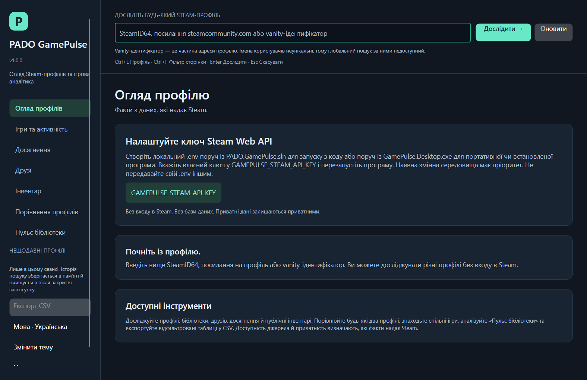
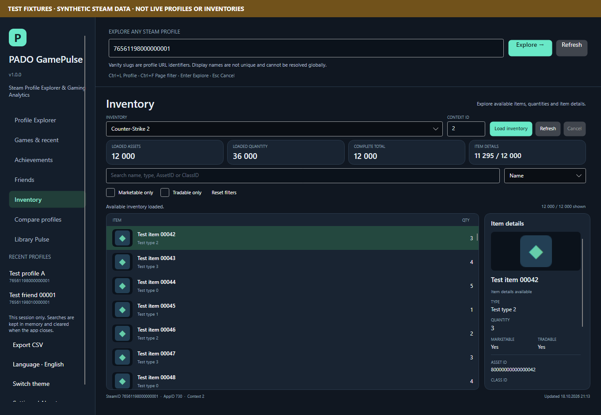
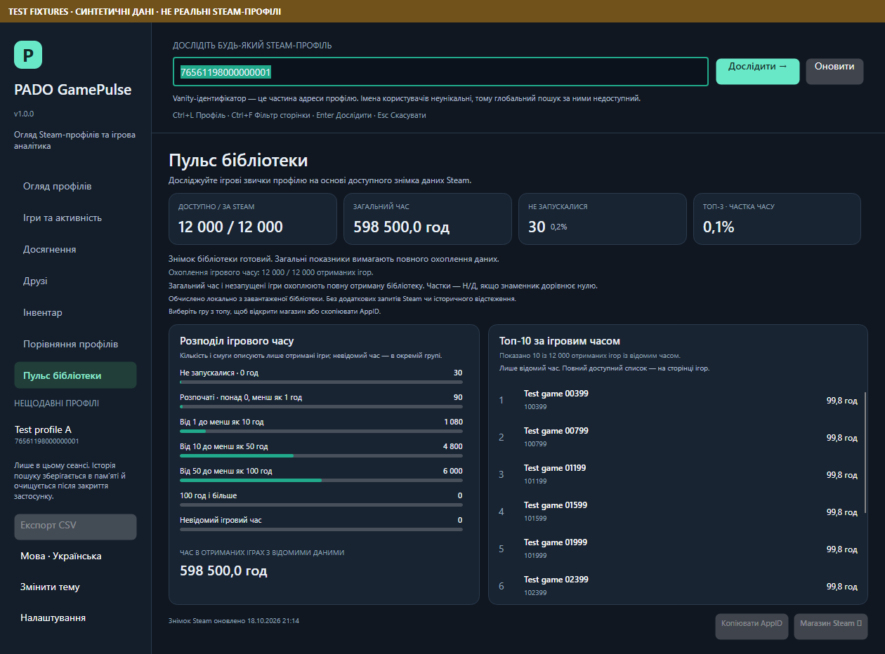

# Release verification — 1.0.0

Executed on 2026-10-18 on the existing Windows x64 host. SDK 10.0.102 and installed runtime
10.0.2 ran automated tests. Windows packages bundle .NET 10.0.13; Avalonia is 12.1.4.
The [0.9 report](RELEASE_0_9_VERIFICATION.md) remains historical evidence.

## Delivered release

Profile Explorer retains arbitrary SteamID/vanity/URL lookup, progressive Summary, Games/recent,
Friends/mini-profiles, lazy selected-game Achievements, paginated Inventory, independent Profile A/B
comparison, Mutual Games and Library Pulse. English/Ukrainian switching, visible-row media, three
accessibility-aware themes and private local .env startup are included.

Version 1.0 adds explicit filtered CSV export with captured snapshots, source timestamps/coverage,
unknown fields, exact identifiers and spreadsheet safeguards. Confirmed response validation,
cancellation, selection, image-request and release-tooling issues were fixed; see the
[audit](RELEASE_1_0_AUDIT.md) and [CSV semantics](CSV_EXPORT.md). Production contains real Steam
transports; fake sources/images remain in test projects.

## Executed application checks

| Check | Actual result |
| --- | --- |
| Restore / Release build | Exit 0; zero warnings/errors |
| Unit tests | 513 passed; one Unix FIFO test intentionally skipped on Windows |
| Fake-HTTP integration | 311 passed; zero failed/skipped |
| Total | **824 passed, one platform skip, zero failures** |
| Resource parity | Seven modules; 529 Ukrainian entries, matching keys/placeholders |
| Actual controls | Language button updates mounted text/accessibility while retaining profiles, comparison inputs, lists, sorts, filters, selections and OS formatting |
| Images | Visible-only lifecycle, cancellation/recycling/stale rejection/disposal, decode/TTL/cache bounds, concurrent same-image gates and independent cancellation |
| Large sources | 12,000 games/friends/achievements/inventory assets; 6,000 mutual games; bounded realization, last rows reachable |
| DPI/themes | 24 configurations × seven pages = 168 passed checks |
| Ukrainian layouts | Two sizes × three themes × seven pages = 42 passed checks |
| CSV | 38 cases: scope/projection, unknowns, formula/Unicode/quoting/precision, cancellation, captured snapshots, stream replacement/BOM/errors/disposal |
| Export UI | Supported-page availability and unavailable-table Ctrl+Shift+E path passed |
| Native startup | Eight English/Ukrainian default/minimum theme captures; intentional invalid screenshot parent exits 1 |
| Native Windows UIA | Passed: editable focus/ValuePattern, exact invalid-input status, seven navigation InvokePatterns, live language names/status, retained input, PerMonitorV2 |
| NuGet advisories | Seven projects including transitive dependencies; zero reported vulnerable packages on the verification date |
| Release helper checks | 30 isolated cases passed under both PowerShell 7.6.5 and Windows PowerShell 5.1; absence/empty environment and path/payload guards |
| Source/retirement safety | Safe exclusion/example/path/reparse/no-overwrite/Git-ignore and conservative retirement fixtures passed |

The approved complete publish pipeline ran restore/build/tests/headless/native checks without skip
switches against the final source. It includes the shorter Ukrainian sidebar label and a final CSV
regression fix: a mutual-game AppID display fallback is not exported as a Steam-supplied name. The
additional test verifies that an actually unknown name remains an empty cell.

Raw evidence: [tests](performance/release-100-test-results.json),
[large-list metrics](performance/release-100-ui-check-results.json),
[DPI](performance/release-100-dpi-accessibility-results.json),
[Ukrainian layouts](performance/release-100-localized-layout-results.json),
[native UIA](performance/release-100-native-accessibility-results.json),
[dependency advisories](performance/release-100-dependency-audit.json),
[PowerShell 7](performance/release-100-support-pwsh-results.json),
[Windows PowerShell](performance/release-100-support-windows-powershell-results.json),
[source-export safety](performance/release-100-source-archive-safety-results.json),
[Windows PowerShell source export](performance/release-100-source-archive-safety-windows-powershell-results.json),
[retirement safety](performance/release-100-retirement-generator-results.json).

The standalone default-source export command also passed under Windows PowerShell 5.1 and
PowerShell 7, from an unrelated working directory using only an isolated synthetic project.
Cross-platform UI checks use a deliberately oversized description to verify actual scrolling
without depending on one system font's word widths. Expected negative Git-ignore fixture codes
are checked explicitly and do not masquerade as a failed CI job after successful assertions.

The large-list figures are labeled synthetic local observations, not Steam latency, native FPS,
historical activity or real users. No universal speed multiplier is claimed.

## Windows distribution

The self-contained payload includes .NET 10.0.13, 38 production-package notices plus runtime notices,
the owner-selected MIT LICENSE and Ukrainian satellite resources. Actual installer/archive results
are linked below and in the [upgrade policy](INSTALLER_UPGRADE.md). Local environment files, build/IDE
caches, tests and fixtures are excluded from ZIP/setup.

Native configuration checks use deliberately synthetic work-only credentials without profile searches:
no-file setup, working-directory .env, opt-out, environment precedence and malformed-file setup.
User .env files are never read into diagnostics or copied into artifacts.







## Reproduction

From the source root:

```powershell
dotnet restore PADO.GamePulse.sln --disable-parallel -m:1
dotnet build PADO.GamePulse.sln -c Release --no-restore -m:1
dotnet test PADO.GamePulse.sln -c Release --no-build --no-restore -m:1
dotnet run --project tests/GamePulse.UiChecks -c Release --no-build -- artifacts/ui-checks
powershell -NoProfile -ExecutionPolicy Bypass -File scripts/Publish-Windows.ps1 -OutputDirectory artifacts/windows
powershell -NoProfile -ExecutionPolicy Bypass -File scripts/Build-Installer.ps1 -PublishDirectory <publish-folder> -CompilerPath <verified-ISCC.exe> -OutputDirectory artifacts/installer
powershell -NoProfile -ExecutionPolicy Bypass -File scripts/Test-InstallerUpgrade.ps1 -PreviousInstallerPath <0.9.0-setup.exe> -InstallerPath <1.0.0-setup.exe> -PublishDirectory <publish-folder> -TestDirectory <fresh-folder> -CompilerPath <verified-ISCC.exe>
powershell -NoProfile -ExecutionPolicy Bypass -File scripts/Test-LocalEnvironment.ps1 -ExecutablePath <published-exe> -TestDirectory <fresh-folder>
powershell -NoProfile -ExecutionPolicy Bypass -File scripts/Test-ReleaseSupport.ps1 -TestDirectory <fresh-folder>
powershell -NoProfile -ExecutionPolicy Bypass -File scripts/Test-SourceArchive.ps1 -TestDirectory <fresh-folder>
powershell -NoProfile -ExecutionPolicy Bypass -File scripts/Export-SourceArchive.ps1 -OutputDirectory <outside-source-folder>
```

Verification disables private local-file loading except for explicit isolated synthetic tests. Installer
checks refuse existing registration/shortcuts. Source export excludes actual .env before reading payload
bytes and validates the sole allowed empty-key .env.example.

## Scope and external acceptance

Native UIA is verified; audible Narrator and screen-reader live-event delivery are not certified.
The native Save dialog's complete manual keyboard flow and interactive installer listening review
remain in [accessibility acceptance](ACCESSIBILITY_ACCEPTANCE.md). Generic storage writes can leave a
partial chosen CSV after I/O failure/cancellation; failure is never reported as success.

No credentialed live Web API request was executed for this release. Permitted fresh-key live profile,
library, friends, achievements and independent comparison cases remain an opt-in matrix. Earlier
[live inventory evidence](LIVE_SOURCE_VERIFICATION.md) keeps its actual date/scope; positive PUBG/Rust
contexts remain unverified. No legacy key was read or reused; rotate any exposed archive key.

Packages are unsigned. Existing-host and CI checks do not prove a clean Windows machine, physical
multi-monitor behavior or every Steam context. No mandatory database/server/login, privacy bypass,
external telemetry, historical snapshots or automatic updater was introduced. MIT/dependency licenses
are retained. Older installers cannot acquire newer version guards retroactively.

## Final installer and local configuration evidence

Actual **0.9.0 → final 1.0.0** upgrade passed with native UIA enabled: all payload hashes matched;
the directory/desktop task and both shortcuts were preserved. Same-version reinstall, newer/missing/
malformed registered-version rejections, retirement fixtures and uninstall passed. The private synthetic
.env survived every stage; exactly the two unmanaged test files remained after uninstall.
See [upgrade results](performance/release-100-installer-upgrade-results.json) and
[installed UIA](performance/release-100-installed-accessibility-results.json).

The initial fresh-install run passed before the sole cosmetic label shortening; the final installer
was exercised by actual upgrade/reinstall checks. Its [fresh-install history](performance/release-100-fresh-install-results.json)
is retained with that scope. Final [local configuration checks](performance/release-100-local-environment-results.json)
passed all five isolated scenarios. A supplemental run timed out under concurrent compression/build/
headless load after writing a startup report; the identical final run passed serially. This is not
claimed as a startup-latency benchmark or clean-machine proof. Test-owned registrations/shortcuts were removed.

## Final artifact checks

Final ZIP CRC, safe paths/extraction, all 288 managed file comparisons, runtime/resources/license and
absence of local configuration/test payloads passed. The extracted EXE passed no-key startup and
adjacent .env fallback from another working directory using only a synthetic credential.
See [package results](performance/release-100-package-results.json) and
[extracted startup](performance/release-100-extracted-startup-results.json).

The source exporter validates the empty template and excludes private settings before opening payload
bytes. Publication additionally checks staged Git paths, credential-shaped content and .env ignores.
Release SHA256 sidecars accompany all three artifacts. Hosted CI status is available on
[GitHub Actions](https://github.com/PADOALEX/PADO-GamePulse/actions/workflows/ci.yml); the local results
above do not assume a hosted job passed before its conclusion is available.

The approved rerun, including the final unknown-name CSV correction, completed with no failed attempts: 824 tests, 210 page checks, native startup/UIA, actual upgrade and serial local-configuration checks all passed. Earlier candidate artifacts are preserved under work and are not the published release. Release helpers additionally accept legitimate +GitRevision build metadata while comparing the stable three-part product version; 30 cases passed in each PowerShell host.
